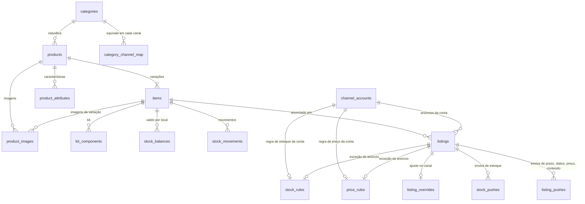

# DACH Hub — Produtos, Marketplaces e Aplicativos

Planejamento das telas aprovadas na prévia de 11/11/2026: cadastro central de produtos, painel por marketplace (anúncios, contas e regras), estoque e prazo controlados no produto, e aplicativos (ERPs). Nada aqui foi codado ainda.

## Princípios

1. **O produto é a fonte da verdade.** Estoque, prazo, "quando acabar o estoque", preço, custo, medidas, imagens e descrição são cadastrados no produto (ou na variação) e vão para todos os anúncios ligados a ele, em todos os canais e contas.
2. **Os marketplaces só recebem.** Nas telas de anúncios, estoque e prazo aparecem só para conferir ("vem do cadastro"). O que cada canal tem de próprio é a **regra da conta** (preço e estoque) e o **ajuste do anúncio** (título, descrição, imagens ou preço próprios).
3. **Cada canal no formato da sua API.** ML: anúncio MLB + variação, prazo de fabricação. Shopee: item + modelo, dias para envio (prazo longo vira pré-venda). Magalu: SKU do lojista, prazo de despacho.
4. **Escrever nos canais é sempre em etapas:** primeiro "o que mudaria" (observação), depois envio só para as empresas do piloto (`HUB_WRITE_TENANTS`), com histórico e conferência relendo o anúncio — como o estoque já faz hoje.
5. **Divisão com o módulo DACH ML:** o Hub cuida do multicanal (cadastro, preço, estoque, conteúdo e vínculo). Promoções, atacado, clonar e demais operações avançadas do ML continuam só no módulo DACH ML, sem atalho por enquanto.

## O que já existe e será reaproveitado

| Tabela | Hoje | No plano |
|---|---|---|
| `hub.items` | SKU solto: sku, nome, EAN, marca, simples/kit | Vira a **variação** (SKU vendável) de um produto |
| `hub.kit_components` | Componentes de kit | Igual |
| `hub.listings` | Anúncio de cada canal/conta, com `item_id` (vínculo por SKU/EAN/manual), preço lido do canal | Igual; ganha ajuste por anúncio e regra de preço |
| `hub.channel_accounts` | Contas conectadas e modo de estoque (desligado/observação/ativo) | Igual; telas passam para Marketplaces → Configurações |
| `hub.stock_rules` | Regra de estoque por conta ou por anúncio (igual, fixo, %; teto; reserva) | É a **regra de estoque da conta** da tela nova |
| `hub.stock_balances` / `stock_movements` / `locations` | Saldo mestre por item e local, movimentos | Igual (o saldo do produto é a soma das variações) |
| `hub.stock_pushes` | Fila de envio de estoque com conferência | Igual; prazo, status, preço e conteúdo usam uma fila irmã |
| `hub.audit_events` | Auditoria | "Histórico de alterações" de produtos, anúncios e regras |

## Tabelas novas

**`hub.categories`** — categorias do Hub (árvore).
`id`, `tenant_id`, `parent_id → categories`, `name`, `position`.

**`hub.products`** — o produto (pai).
`id`, `tenant_id`, `code` (código do produto, único por empresa), `name`, `description`, `brand`, `model`, `category_id → categories`, `status` (`active`/`inactive`), `warranty`, `items_included`, `origin` (`manual`, `channel_import`, `spreadsheet`, `erp`), `origin_ref`, e a **política de estoque padrão**:
`lead_time_days` (0 = imediata, até 30), `out_of_stock` (**opcional**: `zero`, `inactive`, `backorder`; vazio = `zero`), `backorder_lead_days` (0 = entrega imediata, até 30), `backorder_stock` (quanto mostrar nos canais vendendo sem estoque), `min_stock`, `notify_low_stock`.

**`hub.items` (colunas novas)** — a variação.
`product_id → products`, `variation` (ex.: `{"Cor": "Bege"}`), `reference`, `price`, `promo_price`, `promo_starts_at`, `promo_ends_at`, `cost`, `weight_g`, `height_cm`, `width_cm`, `length_cm`, `position`, e as **mesmas colunas de política de estoque, opcionais** (vazio = herda do produto). Produto sem variação = produto com uma variação só, sem `variation`.

**`hub.product_images`** — `id`, `product_id`, `item_id` (opcional: imagem só da variação), `storage_key`, `position`, `is_main`.

**`hub.product_attributes`** — características: `product_id`, `attr_key`, `value`, `source`.

**`hub.category_channel_map`** — categoria do Hub → categoria de cada canal: `category_id`, `channel`, `channel_category_id`, `channel_category_label`; e **`hub.channel_attribute_map`** — característica do Hub → atributo do canal (para publicar).

**`hub.price_rules`** — regra de preço por conta ou por anúncio (mesmo formato de `stock_rules`):
`scope` (`account`/`listing`), `channel_account_id` ou `listing_id`, `base` (`sale`, `promo_or_sale`, `cost`), `adjust` (`pct`, `amount`, `fixed`), `value`, `rounding` (`none`, `90`, `99`), `show_from` (preço riscado), `min_price`.

**`hub.listing_overrides`** — "Ajustar no canal": `listing_id`, `title`, `description`, `images`, quem e quando.

**`hub.listing_pushes`** — fila de envio do que não é estoque: `listing_id`, `kind` (`lead_time`, `status`, `price`, `content`), `desired`, `previous`, `observed`, `state` (mesmo ciclo de `stock_pushes`: pendente → enviando → conferido / divergente / falhou).

**`hub.app_installations`** e **`hub.app_sync_runs`** — aplicativos ligados (ERP, planilha): `app_key`, `status`, credenciais cifradas (mesma chave dos tokens dos canais), `settings` (o que sincroniza e em que sentido) e o histórico de cada sincronização.

## Relações

Em palavras: uma **empresa** tem **produtos**; cada produto tem uma ou mais **variações** (`items`); cada variação pode estar em **vários anúncios**, de vários canais e contas; cada **conta** tem a sua regra de preço e de estoque, e cada **anúncio** pode ter exceção de regra e ajuste de conteúdo.

## Como calcular o que vai para cada anúncio

- **Estoque enviado** = saldo da variação (kit: menor componente) → regra de estoque (anúncio, senão conta) → política de "quando acabar" (da variação, senão do produto, senão `zero`). **Todas as opções são opcionais no cadastro; se o usuário não escolher nenhuma, quando o estoque zerar o Hub envia 0.**
  - `zero` (padrão, também quando o campo fica vazio): envia 0; o anúncio fica publicado e não vende.
  - `inactive`: produto fica inativo e os anúncios são pausados; **continua inativo quando o estoque volta**, até alguém reativar; o Hub avisa quando um produto inativo voltar a ter estoque.
  - `backorder`: envia `backorder_stock` com o prazo `backorder_lead_days`.
- **O saldo nunca fica negativo.** Venda sob encomenda é configurada pelo próprio usuário no produto: prazo longo (ex.: 15 dias) e um estoque alto (ex.: 1.000); as vendas baixam esse número normalmente. Na opção `backorder`, vendas feitas com o saldo em 0 não baixam abaixo de 0: o Hub continua mostrando `backorder_stock` até o saldo voltar.
- **Prazo enviado** = prazo da variação (senão do produto), no campo de cada canal.
- **Preço enviado** = base da regra (anúncio, senão conta) → ajuste → arredondamento → mínimo; preço riscado conforme `show_from`.
- **Conteúdo enviado** = ajuste do anúncio, senão o cadastro (título no limite de cada canal).

## Migração do que existe

1. Cada SKU de `hub.items` ganha um produto. SKUs que hoje aparecem como **variações do mesmo anúncio** (ML: mesmo MLB; Shopee: mesmo item com modelos) viram **variações de um único produto**, com nome tirado do título do anúncio; os demais viram produto simples.
2. Preço, custo, medidas e imagens começam vazios e são preenchidos pela **importação dos anúncios** (preço, título, descrição, imagens do canal), pela **planilha** ou por um **ERP**.
3. `stock_rules` de conta continuam valendo; saldos e movimentos não mudam.
4. A migração **não escreve nada nos canais**.

## Fases

| Fase | Entrega | Escreve nos canais? |
|---|---|---|
| **1. Marketplaces** | Menu Marketplaces (ML, Shopee, Magalu); anúncios por canal com filtros por conta; Configurações com contas (Usar no Hub / Conectar / limite do plano), regra de estoque (de `stock_rules`) e regra de preço gravada com "o que mudaria". Tabela `price_rules`. | Não |
| **2. Produtos** | Tabelas de produto, variação, imagem, categoria e características; lista com status colorido, edição rápida, editar completo, mais opções; agrupamento dos SKUs atuais; importação dos anúncios e planilha. | Não |
| **3. Estoque e prazo** | Política de estoque no produto e na variação; envio de prazo e de pausa além do estoque; aviso de produto inativo com estoque. | Sim, piloto |
| **4. Preço** | Regras aplicadas; envio de preço com conferência. | Sim, piloto |
| **5. Conteúdo** | Ajuste no canal; envio de título, descrição e imagens. | Sim, piloto |
| **6. Publicar no canal** | Relação de categorias e atributos obrigatórios; criar anúncio a partir do produto. | Sim, piloto |
| **7. Aplicativos** | Catálogo e "Meus aplicativos"; Planilha como aplicativo; primeiro ERP. | Não (lê do ERP) |

Cada fase entra em produção sozinha, com testes e com o roteiro de prévia atualizado.

## Andamento

- **Fase 1 (Marketplaces): pronta localmente em 13/11/2026, ainda não publicada.**
  - Menu Marketplaces (visão geral e um item por canal, vindo do catálogo de canais). Painel de cada canal em `/hub/marketplaces/<canal>`, com as abas Anúncios, Contas e Regras de preço e estoque.
  - **Anúncios:** filtros (conta, busca por código, SKU ou título, situação, vínculo, regra de preço), atalhos com contagem, estoque que o Hub enviaria (mesmo cálculo do "O que mudaria", só para conferir) e a regra de preço que vale para cada anúncio. Cada anúncio pode ter regra de preço própria.
  - **Contas:** a tela de contas filtrada pelo canal. Conectar ou reconectar volta para a aba Contas do canal.
  - **Regras:** regra de preço (`hub.price_rules`, migração 013) e regra de estoque de cada conta. Como o cadastro ainda não tem preço (fase 2), o "o que mudaria" do preço é uma **simulação com um produto de exemplo**; a comparação anúncio a anúncio entra quando o produto tiver preço.
  - Relacionamento de categorias fica para a fase 6, como planejado.

## A confirmar com cada API (antes das fases 3 a 6)

- Campos e limites de prazo: ML (prazo de fabricação), Shopee (dias para envio e regra de pré-venda), Magalu (prazo de despacho).
- Pausar/reativar anúncio e o que cada canal faz com estoque 0.
- Limites de título, quantidade e formato de imagens.
- Atualização de preço por variação/modelo/SKU e limites de chamadas.

## Decisões

1. **Código do produto (decidido):** gerado pelo Hub, sequencial por empresa, como na Tray. O usuário informa a **Referência** (e o SKU de cada variação).
2. **Imagens (decidido em 13/11/2026):** o Hub guarda as imagens em arquivo, fora do banco, e no banco só a referência (`storage_key`).
   - **Como a Tray faz (medido na loja da DROSSI em 11/11/2026):** as imagens ficam no CDN da própria Tray (`images.tcdn.com.br/img/img_prod/475075/...`, servidor nginx, cache de 30 dias). O arquivo enviado é guardado como veio: das 10 imagens medidas, 8 tinham 1000×1000 px, uma 1024×1024 e uma 2160×2160 px, entre 83 KB e 677 KB, todas JPEG. A Tray não publica um limite oficial para a loja; o guia dela para marketplaces cita 2 MB por imagem (Shopee) e um manual de tema recomenda cadastrar em 1000×1000 px, com miniatura de 180×180 px.
   - **Limite no cadastro (decidido, igual ao da Tray):** JPG, JPEG e PNG, até **5 MB** por arquivo e até **2.500 px** no lado maior. Imagem menor que 800 px recebe aviso (pode ser recusada no Magalu).
   - **O que o Hub guarda de cada imagem (enxuto):** uma **versão para os canais** em JPEG, nas mesmas medidas do envio (até 2.500 px), comprimida para ficar abaixo do limite de cada canal (a confirmar com cada API; o guia da Tray cita 2 MB na Shopee), e uma **miniatura** de 300 px para as listas. O arquivo original é descartado depois da conversão. Estimativa: ~350 KB por imagem; 3.500 produtos × ~8 imagens ≈ 10 GB por empresa desse porte.
   - **Os canais copiam a imagem:** o ML e o Magalu baixam a imagem pelo endereço público no momento do envio e passam a servir de lá; a Shopee recebe o arquivo por upload. Ou seja, o Hub só precisa da imagem no ar na hora de publicar ou atualizar; anúncios já publicados não dependem do Hub para mostrar a foto.
   - **Importação:** imagens importadas da Tray ou dos canais são **copiadas** para o armazenamento do Hub, nunca apontadas para o endereço de outro sistema (se o cliente sair da Tray, os links morrem).
   - **Onde guardar (decidido): no disco da VPS, pronto para migrar para o Cloudflare R2.**
     - **Agora:** um volume Docker próprio (`seller-hub-media`), montado no `seller-hub`. O Hub serve as imagens num caminho público com cache longo (ex.: `https://dachbyte.tech/hub/media/<chave>`), pelo Caddy.
     - **Uma interface de armazenamento** no código, com duas implementações: `local` (pasta no volume; também usada no desenvolvimento) e `s3` (R2 ou qualquer compatível com S3). Operações: gravar, ler, apagar, existe e endereço público. Nada no código fora dessa interface sabe onde o arquivo está.
     - **Configuração por variáveis:** `HUB_MEDIA_DRIVER` (`local`/`s3`), `HUB_MEDIA_DIR`, `HUB_MEDIA_PUBLIC_BASE_URL` e, para o S3, `HUB_MEDIA_S3_ENDPOINT`, `HUB_MEDIA_S3_BUCKET`, `HUB_MEDIA_S3_ACCESS_KEY`, `HUB_MEDIA_S3_SECRET_KEY`.
     - **Chave neutra:** `<tenant>/<produto>/<imagem>-<versão>.jpg` (versão = `canal` ou `mini`), igual nas duas implementações. A imagem nunca é sobrescrita: trocar a foto gera uma chave nova, então o cache longo é seguro.
     - **O banco guarda só a chave**, nunca o endereço completo; o endereço é montado com `HUB_MEDIA_PUBLIC_BASE_URL`. Na migração, nada no banco muda.
     - **Migrar para o R2:** criar o bucket com domínio público, copiar a pasta para o bucket (ex.: `rclone sync`, que pode rodar mais de uma vez), trocar as variáveis e reiniciar o `seller-hub`. Anúncios já publicados não são afetados, porque os canais têm a própria cópia.
     - **Cuidados enquanto estiver na VPS:** conferir o espaço livre do disco antes de ativar e mostrar no Hub o espaço usado; o volume de imagens fica fora do backup do banco, e uma cópia de segurança fora da VPS fica para depois (o R2 resolve isso).
   - **No banco:** só a referência (`storage_key`), as medidas, o tamanho e a ordem.
3. **ERPs:** ficam para o futuro. A fase 7 entra só com a tela de Aplicativos e a Planilha; a escolha do primeiro ERP fica para depois.
4. **Limite de imagem (decidido em 12/11/2026):** igual ao da Tray: JPG, JPEG e PNG, até 5 MB e até 2.500 px. Guardadas no disco da VPS, prontas para ir para o R2 (item 2).
